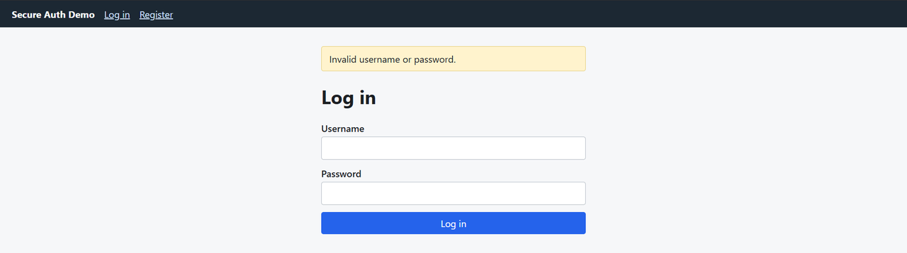
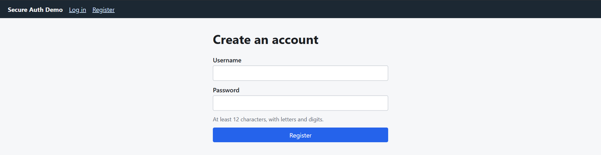

# Secure Flask Authentication

> **Personal project** · Python · Flask · SQLite · pytest

A small Flask web app with a hardened login system, plus runnable demos that show
two classic web vulnerabilities (SQL injection and XSS) next to their fixes. I built
it to practise secure-by-design authentication and to be able to explain *why* each
control exists, not just that it exists.

It is a learning/portfolio project, not a production identity provider.

## Screenshots

| Login: generic error message | Registration |
|---|---|
|  |  |

The login error is deliberately identical for an unknown username and a wrong password, so an
attacker cannot use it to discover which usernames exist.

## Security features

| Threat | Control | Where |
|---|---|---|
| Stored passwords stolen | Salted, slow hashing (Werkzeug scrypt); plaintext never stored | `app/auth.py` |
| Weak passwords | Min. 12 chars, letters + digits, must not contain the username | `validate_password()` |
| SQL injection | Bound parameters on every query | `app/db.py`, `app/auth.py` |
| XSS | Jinja2 auto-escaping + strict Content-Security-Policy (no inline script/style) | templates, `app/security.py` |
| CSRF | Per-session token on every POST, constant-time comparison; `SameSite=Lax` cookies | `app/security.py` |
| Brute force | Account lockout after 5 failures for 5 minutes | `login()` |
| Username enumeration | Same status + message for unknown user and wrong password; dummy hash check evens out timing | `login()` |
| Session fixation | `session.clear()` on successful login | `login()` |
| Session theft | `HttpOnly`, `Secure`, `SameSite` cookie flags; 30-minute lifetime | `app/__init__.py` |
| Clickjacking / sniffing / caching | `X-Frame-Options`, `frame-ancestors 'none'`, `nosniff`, `Cache-Control: no-store` | `app/security.py` |
| Forced logout via link | Logout is POST-only and CSRF-protected | `logout()` |
| Auditing | Login/registration events written to an `audit_log` table | `_audit()` |

## Vulnerability demos

Both demos are self-contained (in-memory SQLite / string templates). There is no
deliberately vulnerable server to deploy.

```bash
python demos/sqli_demo.py
python demos/xss_demo.py
```

Example output:

```
Legitimate login (alice):        ('alice', 'user')
Injection against VULNERABLE:    ('admin', 'admin')     <- auth bypassed with  admin' --
Injection against FIXED:         None                   <- parameterised query rejects it

VULNERABLE: <p>Comment: </p>
FIXED:      <p>Comment: &lt;img src=x onerror=&#34;alert(document.cookie)&#34;&gt;</p>
```

The tests in `tests/test_demos.py` assert both behaviours, so the demos can't silently rot.

## Run it

```bash
python -m venv .venv && source .venv/bin/activate     # Windows: .venv\Scripts\activate
pip install -r requirements.txt

export SECURE_COOKIES=0          # local http:// only; leave unset behind HTTPS
export SECRET_KEY="$(python -c 'import secrets; print(secrets.token_hex(32))')"
flask --app app run
```

Open http://127.0.0.1:5000, register an account, log in.

## Run the tests

```bash
pytest -v
```

18 tests cover: auth flow, password hashing, password policy, duplicate users,
enumeration resistance, lockout, CSRF rejection, POST-only logout, security headers,
cookie flags, SQL injection and XSS attempts, and both vulnerability demos.

## Project layout

```
app/
  __init__.py     application factory and security-related config
  auth.py         register / login / logout / dashboard
  db.py           SQLite helpers and schema
  security.py     CSRF protection and response headers
  templates/, static/
demos/            sqli_demo.py, xss_demo.py
tests/            pytest suite
```

## Known limitations (and what I'd do next)

- **Lockout is per account, stored in SQLite.** A real deployment would add per-IP
  rate limiting (e.g. Flask-Limiter with Redis) and alerting. Per-account lockout
  also lets an attacker lock a victim out on purpose.
- **No MFA, email verification, or password reset.** Those are the obvious next features.
- **Behind a reverse proxy,** `request.remote_addr` needs `ProxyFix` to log real client IPs.
- **No HTTPS termination included.** Run behind a TLS-terminating proxy; keep `SECURE_COOKIES=1`.
- **SQLite** is fine for a demo; use a server database for anything multi-user.